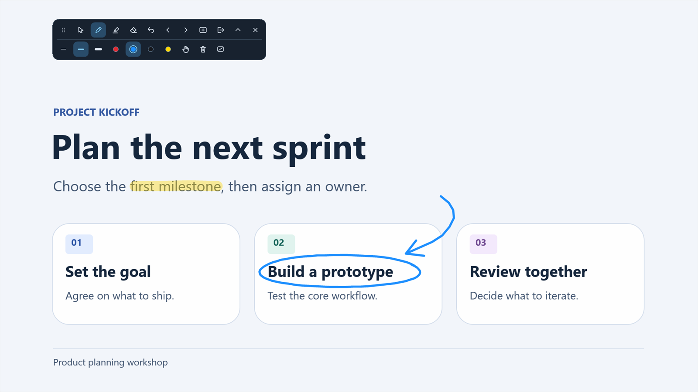
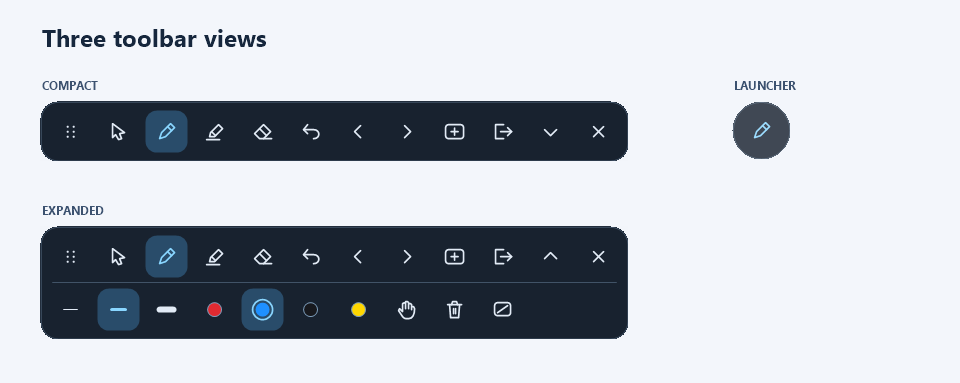

# Interactive Display for PowerPoint

Write, highlight, and erase directly on a running PowerPoint slide. Use the floating toolbar to navigate, add blank slides, and keep annotations as editable PowerPoint shapes when the show ends.

**Windows 11 · 64-bit desktop PowerPoint · C# COM add-in prototype**

[Get started](#get-started) · [Toolbar](#toolbar) · [Samsung WAF setup](#samsung-waf-setup) · [Development](#development)



## Get started

You’ll need 64-bit Windows PowerShell, the .NET Framework compiler, and the desktop Office primary interop assemblies in the Windows Global Assembly Cache. To check PowerPoint’s bitness, open **File → Account → About PowerPoint**. [Check your Office version](https://support.microsoft.com/en-us/office/lifecycle/lc-account/about-office-what-version-of-office-am-i-using) · [Install Office interop assemblies](https://learn.microsoft.com/en-us/visualstudio/vsto/how-to-install-office-primary-interop-assemblies?view=visualstudio)

1. Clone the repository or download and extract the source. Open a 64-bit Windows PowerShell window in the project folder.
2. Close PowerPoint, then build and register the add-in for your Windows account.

   ```powershell
   .\scripts\Build.ps1
   .\scripts\Register.ps1
   ```

3. Open a scratch presentation and press **F5**. The floating toolbar appears in **Browse** mode on the slideshow display. Choose **Pen** and draw with a mouse, a pen, or touch.
4. Tap **Exit presentation** or press **Esc**. Choose **Yes** to keep your marks as editable shapes, then use **Save** or **Save As** in PowerPoint to write the deck to disk.

The add-in loads `bin/InteractiveDisplay.dll` from the folder you registered. If you move the folder, close PowerPoint and run `Register.ps1` again from the new location.

## Toolbar



Drag the six-dot handle to move the toolbar. The chevron opens the second row. Use **×** to collapse the toolbar to its circular launcher, then tap the launcher to reopen it. The add-in remembers placement per display when Windows can identify the display.

| Tool | What it does |
| --- | --- |
| **Pen** and **Highlight** | Draw opaque ink or highlight text with translucent color. Expand the toolbar to choose a color or set the pen to **1, 3, or 6 pt**. The width applies to new pen strokes. |
| **Eraser**, **Undo**, and **Clear** | Remove whole strokes, undo changes, or clear this show’s ink from the current slide. |
| **Browse**, **Prev**, and **Next** | Return touch and mouse input to PowerPoint or navigate from the toolbar. Keyboard navigation stays available. |
| **New slide** | Insert a blank slide after the current one and jump to it. Use a standard all-slide show for this action. |
| **Blank** | Black out the slideshow temporarily. Tap it again to restore the slide. |
| **Exit presentation** | End the show with the door-and-arrow button. If you drew marks, the add-in asks whether to keep them. |

Hover over any icon with a mouse to see its name. Ink stays in memory until the show ends. Once kept and saved, the marks can be edited in PowerPoint on a computer without the add-in.

## Samsung WAF setup

1. Connect the board to the PC using **HDMI** for the display and the board’s **USB Touch Out** for touch input. Start a slideshow on the board. [Samsung WAF port specifications](https://image-us.samsung.com/SamsungUS/home/pdf/WAF_Interactive_Leaflet_V3_2_1.pdf)
2. Expand the toolbar and tap the **Palm setup** hand icon. Follow the prompts to draw one short stroke with the pen tip, one with a finger, and one with your palm. The setup samples are omitted from the slide.
3. When **Palm on** appears, swipe across an ink stroke with your palm to erase it. A stationary palm should leave strokes intact. Use **Undo** to reverse a swipe or tap the hand icon to turn palm erase off.

Palm erase depends on the contact widths Windows receives from the board. If calibration shows **Palm unavailable**, use the regular **Eraser**. Calibration is saved by display and resolution when Windows can uniquely identify the display. In mirrored mode without a unique display identity, placement and calibration apply to the current show.

## Development

- [`src/`](src/) contains the C# COM add-in, WinForms toolbar, Windows pointer input, and PowerPoint shape export.
- [`scripts/`](scripts/) contains the build and per-user registration scripts.
- [Design and roadmap](PLAN.md) covers upcoming work, including whiteboard pages and ink recovery.

After a change, close PowerPoint, rerun `Build.ps1`, then start a scratch show. Draw with two pen widths, navigate away and back, and exit from the toolbar. Keep the marks, save the deck, and reopen it to confirm the shapes are editable.

### Troubleshooting

| Symptom | Check |
| --- | --- |
| The build cannot find an Office interop DLL | Check that the desktop Office interop assemblies (`Extensibility`, `office`, and `Microsoft.Office.Interop.PowerPoint`) are installed in the Windows Global Assembly Cache. [Office interop assembly locations](https://learn.microsoft.com/en-us/visualstudio/vsto/office-primary-interop-assemblies?view=visualstudio) |
| The toolbar does not appear during a show | Reopen PowerPoint after registration. In **File → Options → Add-ins**, open **Manage → COM Add-ins → Go** and check that **Interactive Display** is enabled. |
| The display works but touch does not | Check the USB Touch Out connection and verify that touch reaches Windows before starting the show. |

### Uninstall

Close PowerPoint and run the following from the project folder.

```powershell
.\scripts\Register.ps1 -Unregister
```
